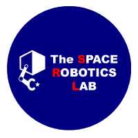
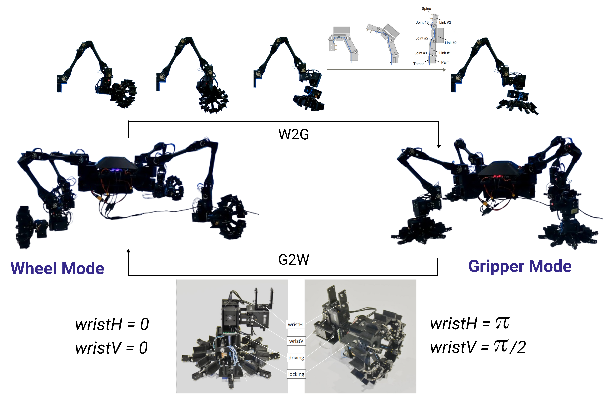
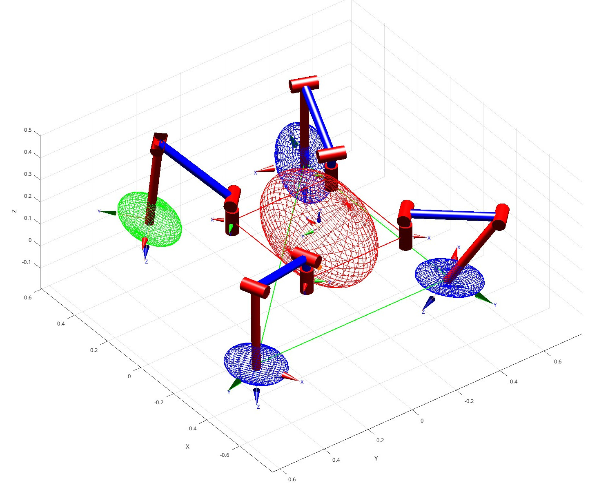

# master-thesis-multimodal-limbed-robot
Master Thesis and Executive Summary LaTeX source of my Master Thesis. This thesis research started during an ExtraEU exchange at the Space Robotics Lab (SRL), Tohoku University, and was concluded in my university: Politecnico di Milano. <br/>

<p align="center">
 &nbsp;
 &nbsp;
 &nbsp;
</p>

<h3 align="center">
Motion Control and Manipulability Analysis of LIMBERO-GRIEEL: a Multimodal Limbed Robot for Unstructured Environments
</h3>
<p align="center">
  <a href="https://alepuglisi.github.io/">Alessandro Puglisi</a><sup>1 (ex 2)</sup>,</span>
  <a href="https://scholar.google.com/citations?user=SiorK6wAAAAJ&hl=it">Luca Bascetta</a><sup>2</sup>,</span>
  <a href="https://scholar.google.com/citations?user=mzUOHycAAAAJ&hl=en">Kazuya Yoshida</a><sup>3</sup>,</span>
  <br>
  <sup>1</sup> RSM-LIRMM, University of Montpellier </span> <br/>
  <sup>2</sup> Politecnico di Milano </span> 
  </span> 
  <sup>3</sup> Tohoku University </span> 
  <br>
  <b>Master Thesis in Automation and Control Engineering</b>
  <br/><br/>
  Academic Year: 2024-25 (Thesis Submitted in March 2025)
</p>

<p align="center">
 &nbsp;
 &nbsp;
</p>

<p align="center">
  <b> Supplementary Materials </b> <br/>
</p>
<p>
  <a href="https://youtube.com/playlist?list=PLFgoOtxCJKTPv_dibdvSUT_YPGDJBc_5C&si=XT7-SM5ew28pVOmt">
    
  </a>
  Check the <a href="https://youtube.com/playlist?list=PLFgoOtxCJKTPv_dibdvSUT_YPGDJBc_5C&si=XT7-SM5ew28pVOmt">YouTube playlist</a> to see the simulations and experiments. <br/>

  
  Check <a href="https://github.com/AlePuglisi/LIMBERO-GRIEEL">LIMBERO-GRIEEL </a> , <a href="https://github.com/AlePuglisi/limbed-robot-control">limbed-robot-control </a> , <a href="https://github.com/AlePuglisi/grasshopper-dexterity-ellipsoid">grasshopper-dexterity-ellipsoid</a> 
  repositories
</p>


<details closed>
<summary  align="center"> Thesis Abstract </summary>
  </br>
Crucial scientific and social activities such as environmental monitoring, exploration of extreme environments, and disaster response have relied on teleoperated robotic systems for as long as these technologies have existed.
Those operations are conducted in dangerous or unreachable environments for humans, where the deployment of machines capable of achieving multiple tasks is inevitable. A clear example is planetary exploration, conducted mainly with wheeled mobile robots since the first remotely operated rover landed on the lunar surface in 1970. 

In recent years, achievements such as improved computing capabilities, 3D perception, environmental awareness, and advanced control techniques have made autonomous systems possible. Furthermore, novel mechanical designs and actuation systems enable locomotion in terrains where moving on wheels is unfeasible. Walking, climbing, flying, and swimming robots are conquering unstructured environments.
However, to complete complex tasks in those settings, a unique locomotion mode is not enough, and the development of multimodal robotic systems is an active research nowadays.     

The robotic system considered in this research is a multimodal four-limbed machine, with walking, climbing, and driving capabilities, thanks to the employed gripper-wheel transformable end-effector. This system's multiple locomotion modes and manipulation abilities enable the efficient execution of complex missions, otherwise requiring the simultaneous deployment of different conventional robots.

This cutting-edge machine is currently a prototype of the Space Robotics Lab, and this work contributes to its preliminary development steps, with the design and implementation of reliable high-level motion algorithms, motion controller design, software architecture integration, simulation setup, and first real system experiments. 

The principal algorithm developed enables a smooth autonomous and adaptable module transformation, maintaining the robot stable with three limbs on the ground while transforming the raised limb. In computing the motion sequence, anticipative planning is used, and feedback from the system state adapts the tasks, considering dexterity and stability in defining the next robot configuration. 

The literature lacks an index of dexterity for multilimbed robots, for this reason, in this research a novel criterion has been defined, extending the theory on robotic arm manipulability ellipsoid. This index proves to be efficient in defining the preferred direction of motion of the robot base in a given configuration. Furthermore, this performance criterion has been tested in the bio-inspired example of a jumping grasshopper. 

The algorithm and the motion controller have been developed and tested into a simulator, configured as part of this research. Finally, tests on the real system have been conducted.

This work has defined the foundation of smooth locomotion transition and system autonomy, still under research for a novel mechanical design. In addition, many future design requirements and components have been derived from the system analysis. 

</details>
</br>

<p align="center">

</p>

## Supplementary Materials: GitHub repositories used in this work

At the implementation level, this thesis can be divided into three main projects: 
- [LIMBERO-GRIEEL](https://github.com/AlePuglisi/LIMBERO-GRIEEL) (ROS2, C++, python) <br/>
Gazebo simulation, robot model, ROS2 control and planning architecture. Updated during the research stay with the SRL and tested on the real robot. Expanded with additional simulation features at Politecnico di Milano. 
- [limbed-robot-control](https://github.com/AlePuglisi/limbed-robot-control) (MATLAB, Simulink, robotics_toolbox by Peter Corke)<br/>
 Robot's limb MATLAB/Simulink modeling and control. URDF to Denavit-Hartenberg conversion. Base manipulability analysis with the novel index proposed in Chapter 3.3 - Novel Base Manipulability Index. 
- [grasshopper-dexterity-ellipsoid](https://github.com/AlePuglisi/grasshopper-dexterity-ellipsoid) (MATLAB, robotics_toolbox by Peter Corke) <br/>
Application of the base manipulability ellipsoid to a bio-inspired example as validation of the novel limbed kinematic theory. Described in Chapter 3.3.3.


## Do you wanna read this Thesis? 

This work has been officially shared in the [POLITesi Archive](https://hdl.handle.net/10589/235457). 

This repository contain the LaTeX source code and the images presented in the Thesis, as well as a compressed version of the originally submitted manuscript (I didn't take care of the compression in that moment).

The compressed version of the manuscript is in [pdf/thesis_compresse.pdf](./pdf/thesis_compressed.pdf),
while the executive summary (a summarized version of the thesis contents) is located in [pdf/executive_summary_compressed.pdf](./pdf/executive_summary_compressed.pdf). <br/>
The non compressed executive summary without loss is also in this repo, in  [pdf/executive_summary.pdf](./pdf/executive_summary.pdf)

Additionally, each chapter has been separated in [pdf/chapters/](./pdf/chapters/) maintaining the original manuscript dimension to avoid any compression loss. Please notice that the hyperlinking is lost in the separated chapters (images, equations, bibliography, supplementary material link)

Please refer to the uncompressed versions or the original images to appreciate plots' labels and diagrams, for this reason both version have been shared here.<br/>
All the images used in this thesis are shared in [thesis_tex/Images/](./thesis_tex/Images/)


## How to compile this (long) LaTeX document 

Note that I compile LaTeX documents in VSCode with an Ubuntu 24.04 machine. Similar set up should hold in a Windows or MacOS machine with VSCode installed. Or refer to the comments below about building the tex file in overleaf...

### Thesis
Building `Thesis.tex` takes a while...the final output will be saved as `Thesis.pdf` on a temporary `.build/` folder (together with all the other building files).

I compile this long LaTeX file in VSCode on an Ubuntu 24.04 machine, with texlive installed 
```
sudo apt install texlive-full
sudo apt install texlive-latex-extra
```

and `LaTeX Workshop` extension installed on VSCode 
(the one by [James Yu](https://marketplace.visualstudio.com/items?itemName=James-Yu.latex-workshop))

The user configuration that I use in VSCode to save all in the .build folder and make everything build as desired is defined in [settings.json](./thesis_tex/settings.json). <br/>
To set it up in VSCode just Open the user preferences with `CTRL+SHIFT+P` and go to `Preferences: Open User Settings (JSON)`.

Then finally it is possible to compile the pdf by opening [Thesis.tex](./thesis_tex/Thesis.tex) and saving (`CTRL+S`) or clicking on the "run" button that appear on the top right (green arrow).

This will take long...<br/>

**Overleaf?**<br/>
With a free overleaf account it will fail due to compilation time exceeded. If you try to compile it in a premium overleaf account, be sure to configure the compiler to xelatex in `File > Settings > Compiler > XeLaTeX`.

### Executive Summary
The same said above holds to compile the Executive Summary. In this case just open [executive_summary.tex](./summary_tex/executive_summary.tex) and compile it by saving or running the LaTeX Workshop compiler. 

**Overleaf?**<br/>
As for the main Thesis, the poor free version of overleaf reach Time out for this document.


